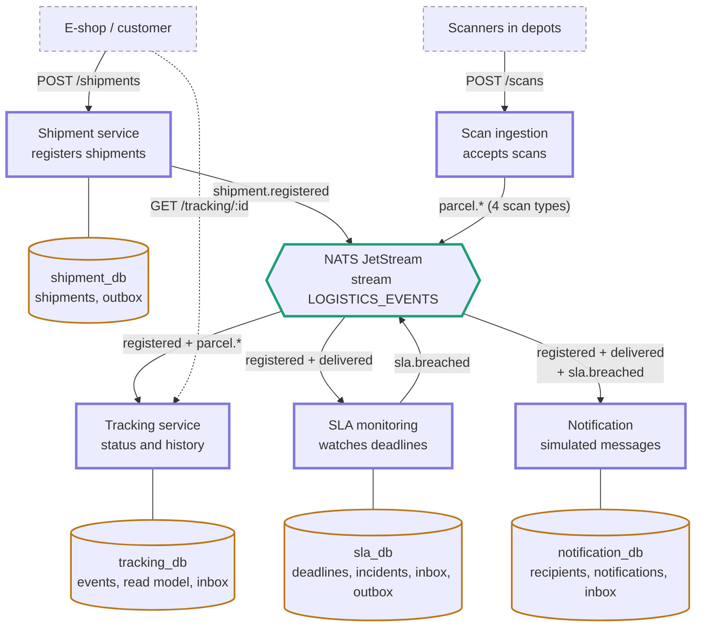

# Architecture

## Overview

Track-and-trace consists of five services that communicate only through events
on NATS JetStream (stream `LOGISTICS_EVENTS`, subjects `logistics.>`). Each
service owns its own PostgreSQL database (database per service), and there are
no synchronous calls between services.

Status: draft – parts marked (planned) are not implemented yet.

## Diagram

How to read it: arrows into NATS are publishing, arrows out of NATS go to
consumers, and lines to databases have no arrow because each service uses only
its own database.

## Services

(planned, phase 2–5) – except the Tracking projection logic, which exists in
[apps/tracking-service/src/domain](apps/tracking-service/src/domain).

| Service        | Input                              | Owns (database)                    | Publishes                 |
| -------------- | ---------------------------------- | ---------------------------------- | ------------------------- |
| Shipment       | `POST /shipments`                  | shipments, outbox                  | `shipment.registered`     |
| Scan ingestion | `POST /scans`                      | no database                        | the four `parcel.*` events |
| Tracking       | NATS                               | events, read model, inbox          | nothing                   |
| SLA monitoring | NATS + its own deadline scheduler  | deadlines, incidents, inbox, outbox | `sla.breached`            |
| Notification   | NATS                               | recipients, notifications, inbox   | nothing                   |

## Durable consumers

[packages/messaging/src/consumers.ts](packages/messaging/src/consumers.ts)

| Consumer         | Filter subjects                                                                                     |
| ---------------- | --------------------------------------------------------------------------------------------------- |
| `tracking`       | `logistics.shipment.registered.v1`, `logistics.parcel.>`                                            |
| `sla-monitoring` | `logistics.shipment.registered.v1`, `logistics.parcel.delivered.v1`                                 |
| `notification`   | `logistics.shipment.registered.v1`, `logistics.parcel.delivered.v1`, `logistics.sla.breached.v1`    |

Which events each consumer receives follows [EVENTS.md](EVENTS.md).

## Processing guarantees

- At-least-once delivery; consumers are idempotent by `eventId` (inbox, planned
  lesson 3.1).
- A consumer ACKs a message only after its database transaction commits.
- The stream and durable consumers are created by `pnpm nats:setup` before services
  start; services only verify them and fail fast.
- Business order comes from `occurredAt`, not arrival order – see
  [docs/tracking-projection.md](docs/tracking-projection.md).
- Services read only their own database; HTTP GET endpoints never read from
  NATS or another service.

## Further reading

- [EVENTS.md](EVENTS.md) – event catalogue and contracts
- [docs/adr/README.md](docs/adr/README.md) – architecture decision records
- [docs/tracking-projection.md](docs/tracking-projection.md) – tracking projection rules
- [docs/acceptance-scenarios.md](docs/acceptance-scenarios.md) – acceptance scenarios
- [AI_USAGE.md](AI_USAGE.md) – AI usage log
